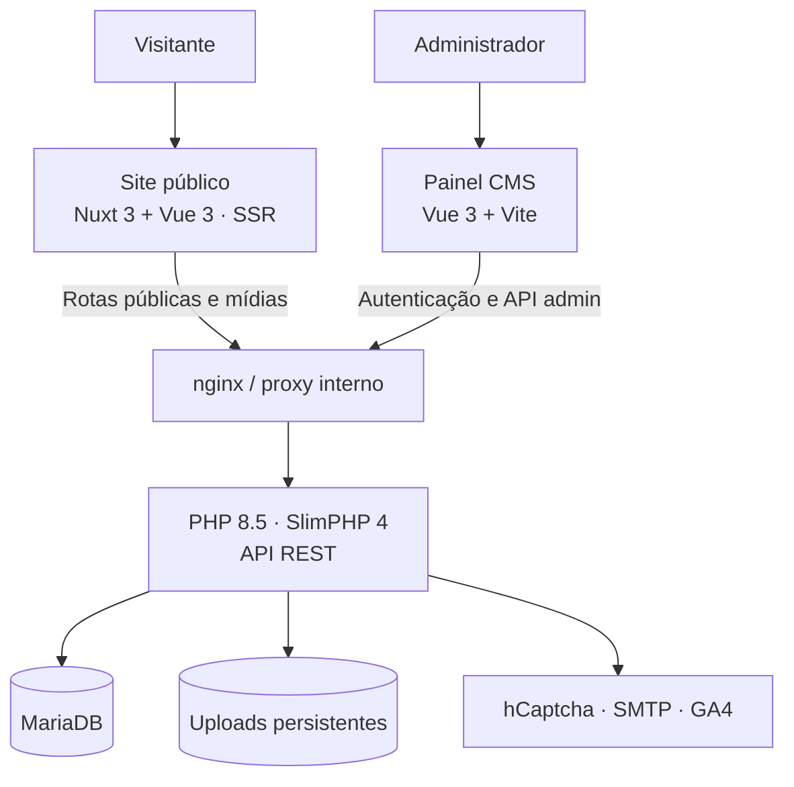

<div align="center">

# FBSantos.com.br

### Uma carreira documentada em uma plataforma construída para evoluir.

**Site profissional · Currículo vivo · CMS próprio · Arquitetura full stack**

[](https://fbsantos.com.br)


[Conhecer o site](https://fbsantos.com.br) · [Arquitetura](docs/architecture.md) · [Segurança](docs/security.md) · [Implantação](docs/production-deployment.md)

</div>

---

## O projeto em uma frase

**O FBSantos.com.br não é somente um currículo hospedado na web.** É uma aplicação profissional completa, desenvolvida para apresentar experiências, responsabilidades, decisões, projetos e aprendizados ao longo de uma carreira — e, ao mesmo tempo, demonstrar em código a capacidade técnica de quem a construiu.

A interface pública é a parte visível de um sistema com **frontend renderizado no servidor, painel administrativo próprio, API REST, persistência relacional, biblioteca de mídias e infraestrutura conteinerizada**. Toda a estrutura foi pensada para continuar útil à medida que novas experiências e projetos surgirem, sem reescrever páginas ou editar diretamente o HTML.

> **Por que não usar um CMS pronto?** Porque a proposta vai além de publicar informações. Projetar o próprio CMS permite evidenciar competências reais em modelagem de domínio, arquitetura de software, integração, segurança, experiência de uso e operação — aplicadas a um produto que precisa funcionar e permanecer sustentável no longo prazo. Não é uma rejeição a ferramentas existentes; é uma decisão consciente, alinhada ao propósito técnico deste projeto.

## Conteúdo

- [O que a plataforma faz](#o-que-a-plataforma-faz)
- [Arquitetura e tecnologias](#arquitetura-e-tecnologias)
- [Decisões e desafios de engenharia](#decisões-e-desafios-de-engenharia)
- [Estrutura do repositório](#estrutura-do-repositório)
- [Executar localmente](#executar-localmente)
- [Preparar e publicar em produção](#preparar-e-publicar-em-produção)
- [Segurança, privacidade e conteúdo](#segurança-privacidade-e-conteúdo)
- [Documentação e verificações](#documentação-e-verificações)
- [Licença e direitos de uso](#licença-e-direitos-de-uso)

## O que a plataforma faz

### Site público: uma trajetória, não uma lista de empregos

- **Páginas dinâmicas:** Início, Sobre, Trajetória, Projetos, Formação, Contato e demais páginas configuradas no CMS.
- **Experiências contextualizadas:** organização, cargo, período, responsabilidades e tecnologias, com possibilidade de relacionar projetos a experiências.
- **Projetos e cases:** páginas próprias, com contexto, participação, solução, desafios, arquitetura, tecnologias, resultados e mídias quando cadastrados.
- **Competências comprováveis:** tecnologias relacionadas a experiências e projetos, evitando depender de percentuais arbitrários.
- **Conteúdo acadêmico e técnico:** formação, certificações, publicações e itens de carreira cadastrados no painel.
- **Composição editorial:** seções ordenáveis, cards, chamadas para ação, galerias, conteúdo em destaque e formulário de contato.
- **SEO e acessibilidade:** SSR com Nuxt, metadados por rota, canonical, Open Graph, dados estruturados quando aplicáveis, sitemap, robots.txt e elementos semânticos.
- **Identidade responsiva:** experiência visual adaptada a desktop e dispositivos móveis, com temas e componentes reutilizáveis.

A publicação não contém um currículo fictício ou dados profissionais de demonstração: **o conteúdo real pertence ao banco administrado pelo CMS**, não a uma migration nem a constantes do frontend.

### Painel administrativo: conteúdo sem alterar o código

O painel, desenvolvido em Vue 3 + TypeScript, permite gerenciar os dados que alimentam o site, incluindo:

| Área | Responsabilidades |
|---|---|
| Páginas e seções | Composição visual, ordenação, visibilidade, textos, imagens e referências a entidades |
| Experiências, organizações e projetos | Cadastro, edição, relacionamentos e seleção do que aparece publicamente |
| Tecnologias e formação | Associação de competências, registros acadêmicos e certificados |
| Publicações, links e mídias | Conteúdo técnico, navegação, uploads e referências externas |
| Configurações do site | Identidade, SEO, menus e informações gerais |
| Operação | Autenticação, painel de indicadores, relatórios de contato/e-mails e Google Analytics 4 quando configurado |

O CMS utiliza **componentes editoriais controlados**, em vez de permitir HTML/CSS arbitrário. Assim, o conteúdo é flexível e o design continua consistente. A mesma entidade pode ser usada em múltiplas páginas sem ser copiada para cada uma delas.

### API e serviços

- API pública para páginas, experiências, projetos e conteúdo institucional.
- API administrativa autenticada para CRUD, uploads, configurações e relatórios.
- Autenticação com cookie de sessão `HttpOnly`, validações de JWT, proteção CSRF e limitação de tentativas.
- Recebimento de mensagens do formulário, verificação de hCaptcha e envio por SMTP.
- Controle de quota de e-mails com janela diária e de 24 horas, permitindo acompanhar a utilização da própria aplicação.
- Biblioteca de imagens e arquivos com validação e processamento de uploads.
- Integração opcional com GA4 Data API para relatórios no painel, com cache no backend.

## Arquitetura e tecnologias



Em produção, os frontends são publicados por **Cloudflare Tunnels separados**. A API não tem túnel próprio: o nginx dos frontends encaminha apenas as rotas necessárias para a rede Docker privada da API. O PHP-FPM e o MariaDB não são publicados diretamente na Internet.

| Camada | Stack | Motivo da escolha |
|---|---|---|
| Site público | Nuxt 3, Vue 3, TypeScript, Composition API | Renderização no servidor, roteamento e SEO sem exigir JavaScript para o conteúdo principal |
| Painel CMS | Vue 3, TypeScript, Vite, Vue Router | SPA administrativa simples, componentes reutilizáveis e desenvolvimento rápido |
| Backend | PHP 8.5, Slim Framework 4, PHP-DI, Composer | API enxuta, responsabilidades explícitas e baixo acoplamento |
| Banco | MariaDB 11.4, SQL versionado por migrations | Modelagem relacional de entidades reais da carreira |
| Infraestrutura | Docker Compose, nginx, PHP-FPM, Node.js 22 | Ambientes reproduzíveis e serviços isolados |
| Integrações | Cloudflare Tunnel, hCaptcha, SMTP, Google Analytics 4 | Publicação, proteção contra automação, comunicação e métricas |

**Princípio arquitetural:** conteúdos e relacionamentos vivem no banco; a API aplica as regras e os controles; o painel os administra; o site os apresenta. Novos projetos e experiências devem exigir **cadastro**, não desenvolvimento de novas páginas.

## Decisões e desafios de engenharia

### 1. Transformar dados de carreira em um domínio de software

Experiência profissional, organização, projeto e tecnologia são entidades diferentes. Um projeto pode se relacionar a uma experiência e usar diversas tecnologias; a mesma tecnologia pode aparecer em vários projetos. A modelagem foi estruturada para representar essas relações, não para preencher blocos estáticos da Home.

**Trade-off:** uma modelagem adequada exige mais trabalho inicial do que inserir dados diretamente em componentes Vue. Em contrapartida, reduz duplicação e permite evolução real do conteúdo.

### 2. Criar um CMS sem criar um page builder irrestrito

O editor de páginas usa seções conhecidas pelo design system, com ordem, visibilidade e conteúdo controlados. Isso permite construir páginas diferentes sem oferecer ao administrador campos para injetar estilos ou marcação arbitrária.

**Trade-off:** novos tipos de seção exigem implementação técnica. É uma limitação intencional para preservar consistência, segurança e manutenção.

### 3. Equilibrar SEO, personalização e velocidade

Um currículo profissional depende de indexação, URLs estáveis e páginas que possam ser compartilhadas. O Nuxt fornece SSR e metadados por rota, enquanto as APIs continuam independentes e o conteúdo permanece no CMS.

**Trade-off:** o site público precisa de uma camada de execução Node/Nitro, enquanto o painel, por ser autenticado, pode ser uma SPA Vite servida estaticamente pelo nginx.

### 4. Administrar conteúdo e arquivos sem duplicar armazenamento

Uploads feitos no painel ficam em uma biblioteca centralizada no backend. Site e painel resolvem `/uploads/...` pelo proxy; não existem cópias independentes dos mesmos arquivos em cada aplicação. Em produção, banco, uploads e cache permanecem em diretórios persistentes do host.

**Desafio operacional:** um backup íntegro do CMS precisa contemplar **dump lógico do banco e mídias correspondentes**. Atualizar contêineres não pode apagar essas informações.

### 5. Segurança sem complexidade artificial

Por existir apenas um administrador, a autenticação foi projetada para usar uma credencial administrativa configurada por ambiente, com senha armazenada somente como hash bcrypt, em vez de uma gestão de usuários desnecessária para o escopo. Essa simplicidade não substitui proteção: cookies seguros, CSRF, validação de entradas, rate limiting, restrição da API e upload validado fazem parte da arquitetura.

**Desafio de manutenção:** configurações seguras dependem da instalação, do gerenciamento correto de segredos e de atualização contínua das dependências. Código público não equivale a garantia de invulnerabilidade.

### 6. Integrar serviços externos sem expor credenciais

A identificação pública do Analytics pertence ao frontend, mas a chave privada de relatórios GA4 é consumida apenas pelo PHP. Da mesma forma, senhas SMTP, credenciais do banco e tokens de túnel ficam em `.env` locais, excluídos do Git.

## Estrutura do repositório

```text
.
├── backend/
│   ├── app/                         # API PHP: rotas, controllers, serviços, segurança
│   ├── database/migrations/         # Schema SQL versionado, sem conteúdo pessoal
│   └── docker/{dev,production}/     # Dockerfiles, Compose e nginx do backend
├── site/
│   ├── app/                         # Nuxt: páginas, componentes, SSR, SEO
│   └── docker/{dev,production}/     # Infraestrutura do site público
├── panel/
│   ├── app/                         # Vue: autenticação e telas do CMS
│   └── docker/{dev,production}/     # Infraestrutura do painel
├── docs/                            # Arquitetura, CMS, segurança e deploy
├── compose.yaml                     # Inclui os três Compose de produção
├── compose.override.yaml            # Redes e dependências entre os módulos
├── LICENSE                          # Licença proprietária — todos os direitos reservados
└── README.md
```

## Executar localmente

**Pré-requisitos:** Docker Engine/Desktop, Docker Compose com suporte a `include` para produção (v2.20.3 ou superior), Git e portas locais `3307`, `8080`, `3000`, `5173` disponíveis. O desenvolvimento usa imagens Docker com PHP e Node; **não é preciso instalar PHP, Composer ou Node na máquina hospedeira** para iniciar esses serviços.

### 1. Baixar e configurar

```bash
git clone https://github.com/fabioedusantos/SitePessoal.git
cd SitePessoal

cp backend/docker/dev/.env.example backend/docker/dev/.env
cp site/docker/dev/.env.example site/docker/dev/.env
cp panel/docker/dev/.env.example panel/docker/dev/.env
```

Edite `backend/docker/dev/.env` com senhas locais fortes, `JWT_SECRET` aleatório, e-mail administrativo de desenvolvimento e `ADMIN_PASSWORD_HASH`. O exemplo vem com credenciais **de exemplo**, que não devem ser usadas em produção.

Para gerar um hash bcrypt com o Docker de desenvolvimento (o comando solicita a senha no terminal):

```bash
docker compose -f backend/docker/dev/docker-compose.yml run --rm --no-deps composer php bin/hash-admin-password.php
```

> Se o serviço `composer` ainda não tiver concluído a instalação das dependências, execute primeiro a etapa seguinte. Alternativamente, use PHP 8.5 instalado localmente em `backend/app/` para executar `php bin/hash-admin-password.php`. Não registre a senha em texto puro no repositório.

### 2. Subir o backend

```bash
docker compose -f backend/docker/dev/docker-compose.yml up -d --build
```

O MariaDB aguarda o healthcheck, o Composer instala dependências e as migrations criam o schema. A API local é servida em `http://localhost:8080` (rota de diagnóstico: `/health`). **O banco nasce sem conteúdo profissional**; o registro técnico para serializar o envio de e-mails é criado automaticamente no primeiro uso desse recurso.

### 3. Subir o site e o painel

Em terminais diferentes:

```bash
docker compose -f site/docker/dev/docker-compose.yml up --build
```

```bash
docker compose -f panel/docker/dev/docker-compose.yml up --build
```

| Serviço | URL local |
|---|---|
| Site público | <http://localhost:3000> |
| Painel CMS | <http://localhost:5173> |
| API PHP | <http://localhost:8080> |
| MariaDB | Porta TCP `3307` |

O site vazio ou com seções incompletas em uma instalação nova é esperado: **cadastre o conteúdo pelo painel**. Para interromper cada stack, use `docker compose -f <caminho> down` com o mesmo Compose; evite `down -v` para não excluir dados dos volumes.

**Importante:** os `.env` de desenvolvimento são independentes dos `.env` de produção. Os serviços de desenvolvimento são executados separadamente, não pelo Compose central da raiz.

## Preparar e publicar em produção

> A referência completa para produção, backup, Cloudflare, validações e atualização está em **[docs/production-deployment.md](docs/production-deployment.md)**. Os comandos abaixo resumem uma **instalação nova, sem importar dados**.

1. Prepare Docker e Docker Compose `>= 2.20.3` no servidor Linux e copie o código, preservando a hierarquia do repositório.
2. Crie os `.env` a partir dos exemplos **de produção** e preencha credenciais reais (banco, admin, JWT, hCaptcha, SMTP e tokens dos túneis). Configure um hash bcrypt da senha, nunca a senha simples.
3. Configure os Cloudflare Tunnels dos domínios do site e painel, sem expor um túnel exclusivo para a API.
4. Suba a stack central e confira healthchecks e logs.

```bash
# Executar na raiz do projeto
cp backend/docker/production/.env.example backend/docker/production/.env
cp site/docker/production/.env.example site/docker/production/.env
cp panel/docker/production/.env.example panel/docker/production/.env
chmod 600 backend/docker/production/.env site/docker/production/.env panel/docker/production/.env

mkdir -p backend/docker/production/data/{db,uploads,cache}

# Após configurar os .env e criar a senha administrativa:
docker compose config --quiet
docker compose up -d --build
docker compose ps
```

Para gerar o hash no próprio servidor, depois de configurar os `.env` necessários para validar o Compose:

```bash
docker compose build backend-app
docker compose run --rm --no-deps --entrypoint php backend-app bin/hash-admin-password.php
```

Configure `ADMIN_PASSWORD_HASH` com o resultado **antes** de colocar o painel no ar. Os dados persistentes de produção ficam em `backend/docker/production/data/{db,uploads,cache}` (fora do Git); não apague essas pastas em atualizações. O banco contém conteúdo do CMS **somente depois do cadastramento ou da restauração de um backup próprio**, nunca porque um currículo veio embutido em migrations.

**Não use `docker compose down -v` para atualizar.** Faça backups consistentes: dump do MariaDB + diretório de uploads. Se estiver migrando um ambiente existente, siga o procedimento de restauração no guia de implantação e valide os dados antes de liberar o tráfego.

## Segurança, privacidade e conteúdo

- `.env`, secrets, tokens, chaves privadas, dumps, diretórios persistentes e `node_modules`/`vendor` não devem ser versionados.
- As migrations públicas descrevem **estrutura do banco**, sem exemplos de currículos, mensagens, contas ou outros dados pessoais.
- A aplicação realiza validações e aplica controles de segurança, mas sua implantação continua dependente de segredos fortes, políticas de acesso, atualizações e observabilidade.
- O painel é privado; a publicação do código **não significa** a publicação das informações cadastradas no banco.
- Conteúdo, imagens e marcas de terceiros utilizados no site podem ter direitos autorais próprios; a disponibilidade de arquivos no Git não altera esses direitos.
- Antes de tornar qualquer histórico público, examine **todos os commits**, não apenas a versão atual, para detectar segredos e dados que não devam ser divulgados. Se um segredo esteve versionado, revogue-o e emita um novo.

Consulte os detalhes em [docs/security.md](docs/security.md).

## Documentação e verificações

| Documento | O que explica |
|---|---|
| [Arquitetura](docs/architecture.md) | Módulos, redes, entidades e composição dos serviços |
| [CMS e editabilidade](docs/cms-editability.md) | Conteúdo estruturado, páginas, seções e referências cruzadas |
| [Segurança](docs/security.md) | Controles de aplicação, infraestrutura, credenciais e limites |
| [Implantação](docs/production-deployment.md) | Procedimento de produção, volumes, backup e diagnóstico |
| [Google Analytics](docs/google-analytics.md) | Configuração GA4 e Data API no painel |
| [Auditoria de conteúdo](docs/content-audit.md) | Critérios para organização do conteúdo editorial |

Verificações rápidas disponíveis no repositório:

```bash
# Validação PHP (com PHP 8.5 disponível no host)
php -l backend/app/src/Service/MailDeliveryService.php

# Teste simples do modelo HTML do formulário de contato
php backend/app/tests/contact-email-template-smoke.php

# Verificação da configuração de infraestrutura de produção
# (depois de criar os .env)
docker compose config --quiet

# Builds isolados de frontend (com dependências instaladas)
cd site/app && npm ci && npm run build
cd ../../panel/app && npm ci && npm run build
```

Essas verificações não substituem testes de integração, revisão de segurança nem validação em ambiente de homologação. O projeto adota atualizações deliberadas de dependências — por exemplo, a evolução de Nuxt 3 para uma linha suportada requer validação específica, não apenas alterar o número da versão.

## Licença e direitos de uso

**© 2026 Fábio Santos. Todos os direitos reservados.**

Este repositório é **público para consulta e avaliação técnica**, mas **não é software livre nem possui licença open source**. O acesso público ao código não concede autorização geral para copiar, reutilizar, modificar, redistribuir, sublicenciar ou criar obras derivadas, exceto quando permitido pela legislação aplicável ou pelos termos da plataforma de hospedagem.

A finalidade da publicação é documentar uma solução real e demonstrar escolhas de arquitetura e qualidade de implementação ao longo da trajetória profissional. Para obter autorização de uso, entre em contato por meio de [fbsantos.com.br](https://fbsantos.com.br).

Leia o texto integral em **[LICENSE](LICENSE)**. As dependências externas permanecem sob suas respectivas licenças, e marcas/conteúdos de terceiros não são licenciados por este documento.

---

<div align="center">

**Código como evidência. Experiência como contexto. Evolução como princípio.**

[**fbsantos.com.br**](https://fbsantos.com.br)

</div>
